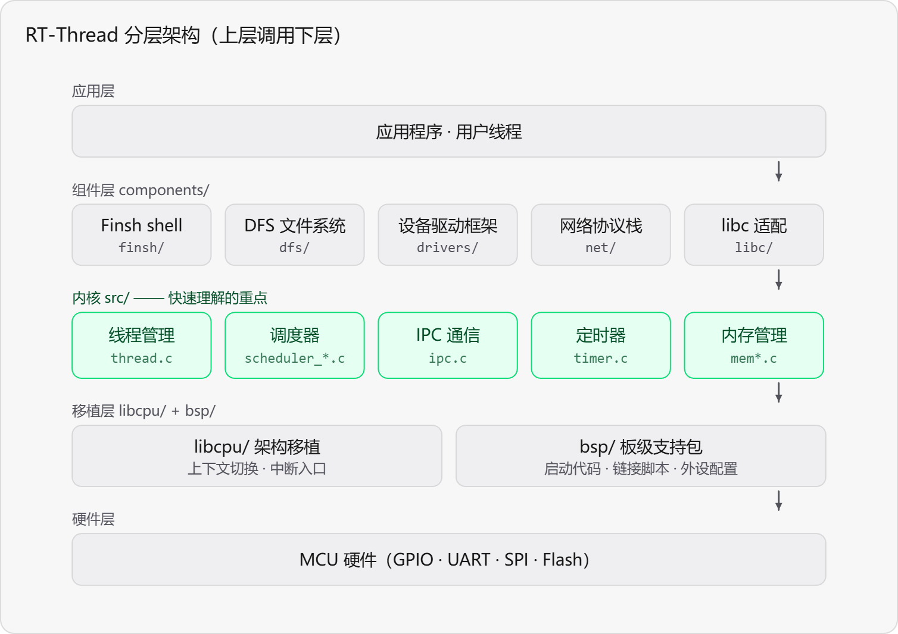
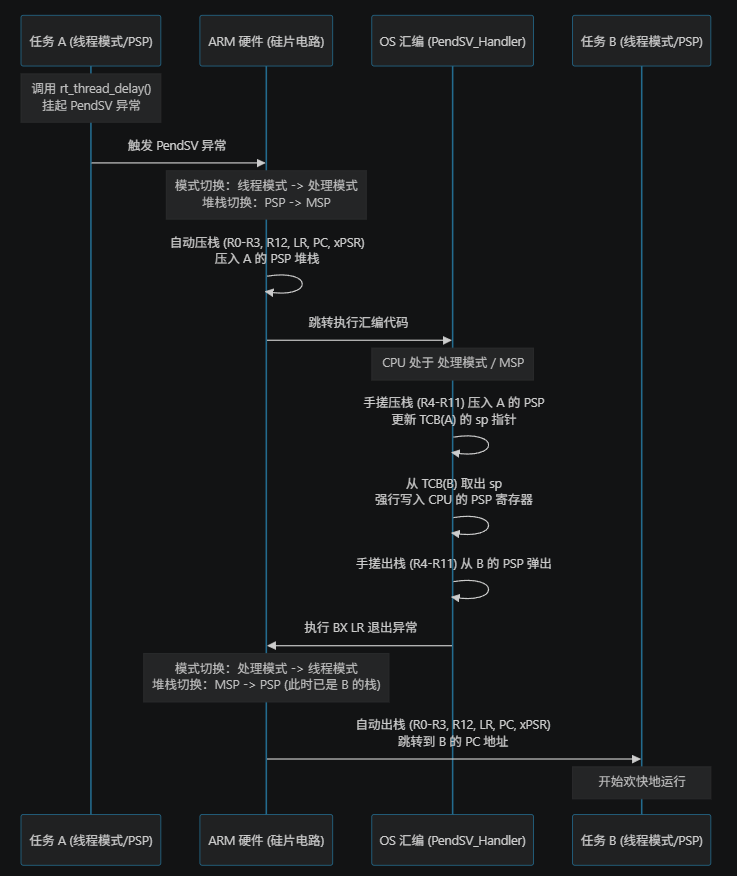

# RT-Thread底层机制深度解析

> 本文档持续记录 RT-Thread 在 Cortex-M3 架构下的底层运行机制、源码剖析及面试高频考点。
> 适用前提：标准版 RT-Thread，未开启用户态保护（所有线程运行于特权级）。

## 目录
- [0、 导读](#导读：如何快速看透一个操作系统？)
- [1、 内存管理](#内存管理)
- [2、 中断与异常管理](#二异常与中断机制)
  - [2.1 SVC 与 PendSV 的区别](#21-svc-与-pendsv-的区别)
- [3、 任务管理](#三实战解析上下文切换全过程)
  - [3.1、 上下文切换全过程](#三实战解析上下文切换全过程)
    - [场景设定](#场景设定)
    - [第一阶段：任务 A 发起“退位”请求（线程态执行）](#第一阶段任务-a-发起退位请求线程态执行)
    - [第二阶段：硬件响应 PendSV（魔法开始）](#第二阶段硬件响应-pendsv魔法开始)
    - [第三阶段：软件保存与恢复（内核态执行）](#第三阶段软件保存与恢复内核态执行)
    - [第四阶段：硬件自动出栈（任务 B 复活）](#第四阶段硬件自动出栈任务-b-复活)
- [4、 扩展区](#五扩展预留区-待补充)

## 🌟 导读：如何快速看透一个操作系统？
任何操作系统（不管是一万行的 FreeRTOS，还是几千万行的 Linux），其最核心的引擎室，就是由**3大核心子系统**撑起来的：
*   **中断与异常管理**（Interrupt & Exception Management）：硬件响应、NVIC 优先级、临界区保护。
*   **任务管理**（Scheduler）：就绪队列、优先级算法、时间片轮转、上下文管理*。这是 OS 的**“交通大脑”**。
*   **内存管理**（Memory Management）：栈分配、动态堆分配、MPU 物理隔离。
所有其他花里胡哨的功能（文件系统、网络协议栈、GUI、甚至你写的点灯程序），本质上都只是跑在这4个基石之上的“应用程序”罢了。


### RT-Thread 内核结构拓扑图



## 1. 内存管理

## 2、 异常与中断管理

### 2.1 SVC 与 PendSV 的区别
*(此处可后续补充：触发方式、优先级、核心作用及在实际开发中的配合。)*

## 3. 任务管理
## 3.1、 上下文切换全过程

**场景设定**：任务 A（低优先级）正在运行，调用了 `rt_thread_delay(10)` 主动让出 CPU。此时任务 B（高优先级）就绪。
 

### 阶段1：任务 A 发起“退位”请求（线程态执行）

1. **调用接口**：任务 A 的代码执行 `rt_thread_delay(10)`。
2. **修改 TCB**：内核修改任务 A 的 TCB：
   - 将状态 `stat` 改为 `RT_THREAD_SUSPEND`。
   - 将 A 从就绪链表（`tlist`）中摘除。
   - 将 A 挂载到系统定时器链表，设定 10 个 Tick 后唤醒。
3. **执行调度器**：底层调用 `rt_schedule()`。
   - **注意**：此时 CPU 仍处于**线程模式（Thread Mode）**，使用的是任务 A 的 **PSP**（进程堆栈）。
   - `rt_schedule()` 只是一个“做决定”的函数。它扫描就绪链表，发现任务 B 的优先级最高，于是决定切换到任务 B。
4. **触发切换请求**：`rt_schedule()` 不会在 C 代码里直接修改 PSP 指针。它调用底层接口，**向 NVIC 的 `ICSR` 寄存器写入数据，挂起（Pend）`PendSV` 异常**。
5. **返回**：`rt_schedule()` 返回，任务 A 的代码继续执行（如果后面还有代码的话），直到遇到中断或触发异常。

### 阶段2：硬件响应 PendSV（魔法开始）

当硬件检测到 `PendSV` 异常被挂起（且没有更高优先级的中断在处理），立刻响应：

1. **硬件自动压栈（保护任务 A 的现场）**：
   - **模式切换**：CPU 从“线程模式”自动切换到“处理模式（Handler Mode）”。
   - **堆栈切换**：堆栈指针由 **PSP** 自动切换到 **MSP**。
   - **硬件压栈**：硬件自动将任务 A 的 8 个寄存器（`R0-R3`, `R12`, `LR`, `PC`, `xPSR`）压入 **任务 A 的 PSP 堆栈**中。
   - **填装 LR**：硬件将特殊的 `EXC_RETURN` 魔法值（如 `0xFFFFFFFD`）写入 `LR` 寄存器。
2. **跳入内核汇编处理**：CPU 跳转到 `PendSV_Handler` 汇编函数开始执行。

### 阶段3：软件保存与恢复（内核态执行）

在 `PendSV_Handler` 中，RT-Thread 的底层汇编代码（如 `context_rvds.S`）开始表演：

1. **保存任务 A 的剩余现场**：
   - 通过 `MRS R0, PSP` 指令，获取任务 A 当前的 PSP 指针。
   - 将剩余的 `R4-R11` 寄存器压入任务 A 的 PSP 堆栈。
   - 将最终的 PSP 指针更新保存到任务 A 的 TCB (`struct rt_thread` 的 `sp` 成员) 中。
2. **获取任务 B 的现场**：
   - 调用 C 语言写的调度函数，找到任务 B 的 TCB。
   - 从任务 B 的 TCB 中读取 `sp` 成员，这就是任务 B 上次被切走时的堆栈指针。
   - 通过 `MSR PSP, R0` 指令，**强行将 CPU 的 PSP 指针修改为任务 B 的栈顶指针**。
3. **恢复任务 B 的剩余现场**：
   - 从任务 B 的 PSP 堆栈中，将 `R4-R11` 弹出到 CPU 寄存器。
4. **修改返程车票**：汇编代码修改 `LR` 寄存器里的 `EXC_RETURN` 值（确保退出时使用正确的模式）。

### 阶段4：硬件自动出栈（任务 B 复活）

1. **触发退出**：汇编代码执行 `BX LR` 指令，准备退出异常。
2. **硬件自动出栈（恢复任务 B 的现场）**：
   - 硬件发现 `EXC_RETURN` 是退回线程模式用 PSP，于是**自动从 MSP 切回 PSP**（此时 PSP 已经是任务 B 的了）。
   - 硬件自动从任务 B 的 PSP 堆栈中弹出那 8 个寄存器（`R0-R3`, `R12`, `LR`, `PC`, `xPSR`）。
3. **状态复位**：CPU 回到 **线程模式 + 特权级**，使用的是任务 B 的 PSP 堆栈。
4. **继续执行**：弹出的 `PC` 指针正好指向任务 B 之前被切走时的下一条指令，任务 B 开始运行。

## 4、 扩展区
### 4.1 启动流程

### 4.2 互斥量
### 4.2.1 spin lock
```
spin_lock:
    LDREX R1, [R0]      ; 1. 尝试独占读取锁变量（比如地址在 R0 里）
    CMP   R1, #0        ; 2. 检查锁是不是 0（开锁状态）
    BNE   spin_lock     ; 3. 如果锁不是 0，说明别人占了，跳回第一步继续死等（自旋）
    
    MOV   R2, #1        ; 4. 准备把锁改成 1（上锁）
    STREX R3, R2, [R0]  ; 5. 尝试独占写入！
    
    CMP   R3, #0        ; 6. 检查写入是否成功（STREX 成功返回 0）
    BNE   spin_lock     ; 7. 如果失败了（比如被别的核抢先了），跳回第一步继续自旋
    DMB                 ; 8. 数据内存屏障（确保锁的内存操作彻底完成）
    ; 拿到锁了，返回！
 整个 Spinlock 的核心，就是 LDREX 和 STREX 在不断循环。  
```
LDREX R1, [R0] 执行的过程：
LDREX R1, [R0] 的本质是：“我不仅要读数据，我还要在物理总线上插个旗子占座。在我拔旗（或别人碰它）之前，这个座位只有我能用。”
只有当 LDREX 成功插旗，且后续的 STREX 检查到旗子还在时，那个“读-改-写”的动作才会完美闭环。

STREX R3, R2, [R0]执行的过程：
它的底层过程就是：“查标记 -> 如果标记还是我的，就写进去并返回成功；如果标记被别人毁了，就立刻撤退，连内存都不写，返回失败。”
### 4.2.2 mutex
Mutex 是内核用纯软件虚拟出来的一把“实名制令牌”，它通过让抢不到锁的线程“挂起睡眠”，并结合“优先级继承”机制，来保护共享资源不被并发踩踏。

### 4.3 HardFault 异常排查

### 4.4 开启 `RT_USING_USERSPACE` 后的 `SVC` 切换机制

### 4.5 位带操作

### 4.6 SysTick